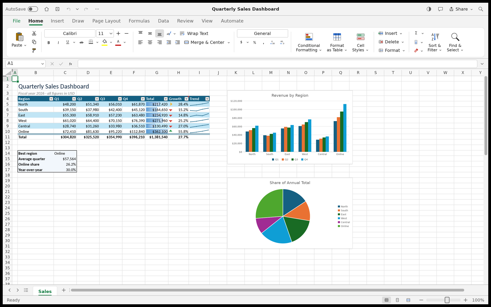

<p align="center">
  
</p>

<h1 align="center">GridKu</h1>

<p align="center">
  Spreadsheet sumber terbuka untuk menghitung, menganalisis, dan membuat grafik data.<br>
  Membuka dan menyimpan .xlsx, berjalan luring, tanpa akun, tanpa telemetri.
</p>

<p align="center">
  
</p>

> **Status:** belum ada rilis bernama GridKu. Rilis yang sudah ada di halaman
> [Releases](https://github.com/andriyanto/gridku/releases) masih bernama GridCraft. Installer
> GridKu akan muncul di sana setelah rilis GridKu pertama. Sampai saat itu, GridKu bisa dibangun
> dari kode sumber (lihat [Membangun dari kode sumber](#membangun-dari-kode-sumber)).

## Apa yang bisa dilakukan

- **Akrab dipakai.** Ribbon, formula bar, Name Box, tab sheet, pintasan keyboard, fill handle,
  referensi berwarna saat mengetik rumus, Format Cells, Paste Special.
- **Rumus.** Lebih dari 500 fungsi lembar kerja, array dinamis yang tumpah ke sel sebelahnya,
  LET, LAMBDA, MAP, REDUCE, referensi tabel terstruktur. Antarmuka berbahasa Spanyol juga
  menerima nama fungsi Spanyol, koma desimal, dan pemisah titik koma.
- **Format.** Format angka lengkap, style sel, format bersyarat (data bar, skala warna, ikon),
  border, tema, mode gelap.
- **Data.** Urutkan, AutoFilter, Flash Fill, validasi data, outline dan subtotal, tabel dengan
  baris total, pivot table dengan pengelompokan tanggal.
- **Grafik dan gambar.** Tujuh belas jenis grafik dengan tab Chart Design dan panel Format,
  sparkline, gambar (juga gambar di dalam sel), bentuk, kotak teks, komentar, tautan.
- **Halaman dan cetak.** Page Break Preview, area cetak, header dan footer, cetak, ekspor PDF.
- **Berkas.** .xlsx dan .xlsm sebagai format utama, juga CSV dan TSV. Membuka buku kerja .xls
  97-2003 (nilai, rumus, dan format angka), serta mengimpor data dari .xlsb dan .ods.

Gambaran jujur per bidang, termasuk yang belum ada, ada di [ROADMAP.md](ROADMAP.md),
[daftar fitur](docs/parity-checklist.md), dan [daftar fungsi](docs/function-parity.md).

## Privasi

GridKu tidak punya akun, telemetri, analitik, atau laporan crash. Buku kerja dan berkas log
tetap di komputer Anda dan tidak dikirim ke mana pun. Rumus yang membaca buku kerja lain hanya
membaca berkas di komputer Anda, dan hanya bila Anda memintanya; fungsi `WEBSERVICE` tidak
tersedia dan tidak mengambil apa pun.

Aplikasi desktop hanya terhubung ke jaringan dalam keadaan berikut:

| Kapan | Ke mana | Apa yang dikirim |
|---|---|---|
| Setiap kali aplikasi desktop dimulai, dan saat memilih **Automate ▸ Check for Updates…** | GitHub (`api.github.com`): daftar rilis `andriyanto/gridku` | Satu permintaan daftar itu, berlabel `GridKu/Update`. Tidak ada data tentang Anda, komputer, atau buku kerja Anda. Seperti permintaan web lain, GitHub melihat alamat IP Anda. |
| Saat menekan **Download** di pemberitahuan pembaruan, atau **Automate ▸ Download Latest…** | Peramban membuka halaman rilis di GitHub. Aplikasi tidak mengunduh atau memasang apa pun sendiri | Yang dikirim peramban Anda. |
| Saat mengeklik tautan di sel atau di jendela About | Peramban membuka alamatnya | Yang dikirim peramban Anda. |

Belum ada pengaturan untuk mematikan pemeriksaan pembaruan saat aplikasi dimulai. Kanal kontrol
dan server MCP hanya berjalan bila Anda menjalankannya sendiri, dan kanal kontrol hanya menerima
sambungan dari komputer yang sama (`127.0.0.1`). Pengelola repo ini tidak menerima data apa pun
dari aplikasi.

## Unduhan dan pemasangan

Setelah rilis GridKu pertama terbit, semua berkasnya ada di
[rilis terbaru](https://github.com/andriyanto/gridku/releases/latest). `<ver>` adalah nomor
versi, dan `SHA256SUMS.txt` memuat checksum setiap berkas.

| Sistem | Berkas |
|---|---|
| Windows x64 | `gridku-<ver>-windows-x64.msi` (installer) atau `gridku-<ver>-windows-x64-portable.zip` |
| Windows ARM64 (Snapdragon) | `gridku-<ver>-windows-arm64.msi` atau `gridku-<ver>-windows-arm64-portable.zip` |
| macOS (Apple silicon dan Intel) | `gridku-<ver>-macos-universal.dmg`; baris perintah: `gridku-cli-<ver>-macos-universal.zip` |
| Linux x86_64 dan aarch64 | `gridku-<ver>-linux-<arch>.AppImage`, `.deb`, `.rpm`, atau `.tar.gz` |

Installer Windows memasang GridKu ke folder `Produktivitas\GridKu`:

| Jenis pemasangan | Folder |
|---|---|
| Hanya untuk saya (bawaan, tanpa hak administrator) | `%LOCALAPPDATA%\Programs\Produktivitas\GridKu` |
| Untuk semua pengguna | `C:\Program Files\Produktivitas\GridKu` |

GridKu adalah aplikasi tersendiri: ia bisa terpasang berdampingan dengan GridCraft dan tidak
memakai pengaturan GridCraft. Pengaturan dan log GridKu ada di `%APPDATA%\GridKu` (Windows),
`~/Library/Application Support/GridKu` (macOS), atau `~/.config/gridku` (Linux dan BSD).

Berkas rilis repo ini **belum ditandatangani (code signing)**, jadi Windows SmartScreen dan macOS
Gatekeeper akan memberi peringatan saat pertama dibuka. Periksa unduhan dengan `SHA256SUMS.txt`.
Aplikasi memberi tahu bila ada versi baru, tetapi tidak pernah memasangnya sendiri: Anda yang
mengunduh dan menjalankannya.

**Kalau aplikasi tidak terbuka di Windows:** coba renderer lain lewat PowerShell, dari folder
tempat `gridku.exe` berada:

```powershell
$env:WGPU_BACKEND = "vulkan"
& .\gridku.exe
Remove-Item Env:WGPU_BACKEND
```

## Membangun dari kode sumber

Perlu Rust versi terbaru (stable).

```sh
git clone https://github.com/andriyanto/gridku
cd gridku
cargo run --release -p gridcraft -- --sample sales     # aplikasi desktop dengan contoh (sales, budget, grades)
cargo run --release -p gridcraft -- laporan.xlsx       # membuka buku kerja
```

Versi web dibangun dengan [trunk](https://trunk-rs.github.io/trunk/) dan target
`wasm32-unknown-unknown`: `cd apps/gridcraft-web && trunk serve --release`.

Paket dan pustaka di dalam kode masih bernama `gridcraft` dan `gridcraft-*`, begitu juga variabel
lingkungan `GRIDCRAFT_*`. Itu nama internal dan tidak tampil ke pengguna; program yang dihasilkan
bernama `gridku` dan `gridku-cli`. `cargo xtask ci` menjalankan format, clippy, tes, pemeriksaan
atribusi aset, pemeriksaan lapisan, dan build wasm.

## Baris perintah dan agen AI

Semua tindakan di GridKu adalah perintah bernama, sehingga bisa dijalankan tanpa antarmuka
grafis lewat `gridku-cli`:

```sh
gridku-cli eval '=XLOOKUP("b",{"a","b"},{1,2})'          # → 2
gridku-cli convert laporan.xlsx laporan.pdf              # xlsx, csv, tsv, json, html, pdf
gridku-cli cat laporan.xlsx --range A1:D20               # isi sel sebagai tabel teks
gridku-cli run --sample budget --cmd 'home.bold={"range":"B4:F4"}' --out budget.xlsx
gridku-cli commands --search chart                       # semua perintah dan parameternya
```

`gridku-cli mcp` menjalankan server MCP untuk agen AI. Untuk mengendalikan aplikasi yang sedang
berjalan, mulai aplikasinya dengan `gridku --control 7979`, lalu jalankan
`gridku-cli mcp --connect 7979`. Rinciannya ada di [docs/mcp.md](docs/mcp.md),
[docs/cli.md](docs/cli.md), dan [docs/control-protocol.md](docs/control-protocol.md).

## Komunitas

Tombol **Join the Community** di GridKu membuka bagian ini.

- **Grup WhatsApp:** [Gabung grup komunitas GridKu](https://chat.whatsapp.com/F0DewxhRINe3WFSrgMAmgD)
  untuk tanya jawab santai dan kabar terbaru. Nomor HP Anda terlihat oleh anggota lain di grup,
  jadi bergabunglah hanya jika Anda nyaman dengan itu.
- **[GitHub Discussions](https://github.com/andriyanto/gridku/discussions):** untuk pertanyaan,
  ide, dan diskusi yang bisa dicari lagi nanti, tanpa membagikan nomor HP.

Laporan masalah sebaiknya tetap lewat [Issues](https://github.com/andriyanto/gridku/issues), supaya
tidak tenggelam di obrolan.

## Bantuan dan laporan masalah

Laporkan masalah atau usulkan perbaikan di
[Issues](https://github.com/andriyanto/gridku/issues). Sertakan versi GridKu (**Automate ›
About GridKu**), sistem operasi, langkah untuk mengulang masalahnya, dan berkas log
`logs/gridku.log` dari folder pengaturan di atas. Jangan melampirkan buku kerja yang berisi data
pribadi.

## Kebijakan code signing

**Status: berkas rilis repo ini belum ditandatangani.** Installer dan program Windows tidak
bertanda tangan, dan build macOS hanya bertanda tangan ad hoc tanpa notarisasi.

Cara rilis dibuat:

- Setiap perubahan masuk ke `main` lewat pull request. Banyak di antaranya disiapkan dengan agen
  AI (Claude), dan commit-nya menyebutkannya; pengelola meninjau dan menggabungkan masing-masing.
- Berkas rilis dibangun oleh GitHub Actions di repo ini dari commit yang ada di `main`
  ([`.github/workflows/release-unsigned.yml`](.github/workflows/release-unsigned.yml)). Tidak ada
  yang dibangun di komputer pribadi lalu diterbitkan.
- Rilis tetap berupa draf sampai pengelola memeriksa dan menerbitkannya.

Peran: committer, peninjau, dan penyetuju adalah [@andriyanto](https://github.com/andriyanto).

## Asal-usul dan lisensi

GridKu adalah versi modifikasi dari [GridCraft](https://github.com/storytold/gridcraft) dan
dikembangkan sebagai proyek tersendiri di repo ini. GridKu tidak dibuat, disponsori, atau
didukung oleh ArtCraft Team; nama dan logo ArtCraft adalah merek dagang mereka dan tidak dipakai
di sini.

Kode berlisensi ganda, pilih salah satu:

- [MIT](LICENSE-MIT)
- [Apache License 2.0](LICENSE-APACHE)

Hak cipta (c) 2026 ArtCraft Team dan para kontributor GridCraft; perubahan untuk GridKu: hak
cipta (c) 2026 andriyanto dan para kontributor GridKu. Pemberitahuan yang diwajibkan lisensi
pihak ketiga ada di [NOTICE](NOTICE), dan setiap aset beserta pembuat, sumber, dan lisensinya ada
di [ATTRIBUTION.md](ATTRIBUTION.md). Ikon GridKu dirancang oleh andriyanto; huruf pada ikon
adalah garis luar DejaVu Sans Condensed Bold (lisensi Bitstream Vera).
